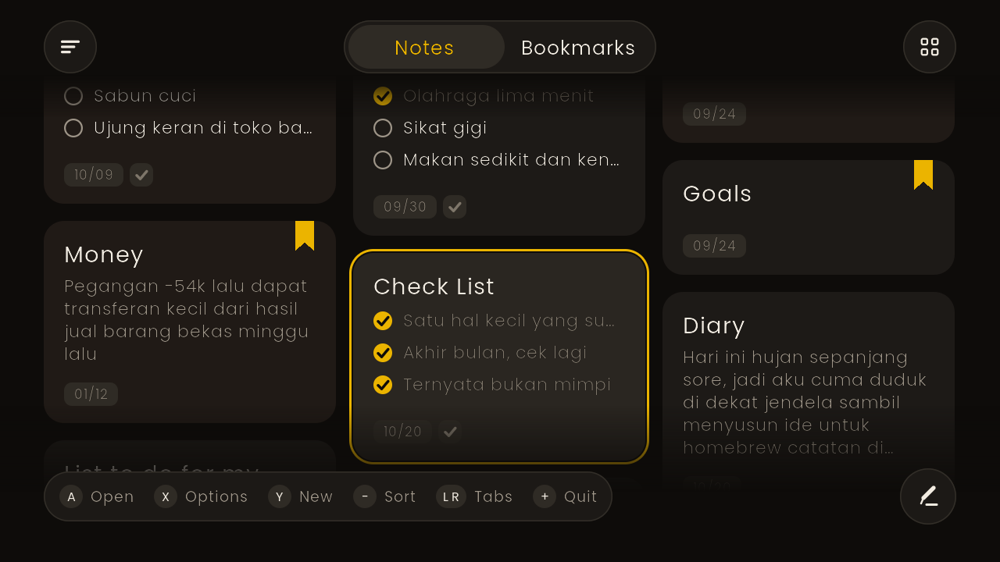

# NoteGrid

Homebrew catatan untuk Nintendo Switch (CFW) dengan tampilan minimalis yang hangat: kartu bulat dalam grid
masonry, aksen kuning, ribbon bookmark, dan chip tanggal di tiap catatan. Kontrol dibuat mirip NX-Shell.



## Kontrol

| Tombol | Fungsi |
|---|---|
| D-Pad / stick kiri | pindah antar kartu (di dalam catatan: scroll) |
| A | buka catatan / pilih |
| B | kembali / batal |
| Y | catatan baru (di dalam catatan: bookmark) |
| X | menu opsi: edit teks, ganti judul, bookmark, hapus |
| - | ganti urutan: terbaru, terlama, judul A-Z |
| L / R | tab Notes / Bookmarks |
| ZL / ZR | jumlah kolom grid (2, 3, 4) |
| + | keluar |

Layar sentuh: ketuk kartu untuk membuka, geser untuk scroll, tahan kartu untuk menu opsi,
tombol bulat kiri atas = urutan, kanan atas = kolom, tombol pensil = catatan baru.

## Penyimpanan

Setiap catatan adalah satu file teks biasa di `sdmc:/switch/notegrid/notes/`, jadi bisa dibaca atau
dibackup dari PC:

```
title: Belanja
date: 2026-10-09
pin: 0
---
[ ] Sabun cuci
[x] Ujung keran
```

Baris yang diawali `[ ] ` atau `[x] ` tampil sebagai checklist di kartu dan di dalam catatan.
Tanggal adalah tanggal catatan dibuat. Pengaturan kolom dan urutan ada di `settings.txt`.

Keyboard Switch dibatasi 500 karakter. Kalau isi catatan lebih panjang dari itu, tombol Edit
menambahkan teks di akhir catatan (tidak memotong isi lama).

## Build

Cara termudah: upload repo ini ke GitHub, buka tab **Actions**, jalankan workflow *Build NRO*, lalu unduh
artifact `notegrid-switch`. Salin isinya ke SD card sehingga file ada di `/switch/notegrid/notegrid.nro`.

Lokal dengan devkitPro:

```
dkp-pacman -S switch-dev switch-sdl2 switch-sdl2_ttf switch-freetype
make
```

## Uji di PC (opsional)

Butuh SDL2 dan SDL2_ttf. Jalankan dari folder proyek supaya `romfs/` ditemukan:

```
g++ -std=c++17 -O2 source/main.cpp $(sdl2-config --cflags --libs) -lSDL2_ttf -o notegrid-pc
NOTEGRID_DIR=./testdata ./notegrid-pc --demo
```

Di PC keyboard dipetakan: panah = D-Pad, Enter = A, Esc = B, X, Y, Q/E = L/R, Z/C = ZL/ZR, `-` = minus.
Input teks (keyboard layar) hanya ada di Switch.

## Status

Tampilan, navigasi, penyimpanan file, bookmark, dan hapus sudah diuji lewat build PC. Bagian yang khusus
konsol (keyboard layar `swkbd`, input sentuh, pad via libnx, romfs) belum diuji di perangkat asli.

Font Poppins (SIL Open Font License 1.1), lihat `NOTICE`.
